> Historical/provider-specific reference. Current commercial rules: [Billing policy](docs/BILLING_POLICY.md). Current launch procedure: [Paddle go-live](docs/PADDLE_GO_LIVE_ZH.md). Older prices and activation steps below are not current release instructions.

# M2V 用户授权、商业交易与任务状态机架构规范文档

> **版本**：v1.0.0  
> **更新时间**：2026-10-12  
> **状态**：已定稿待实现  
> **适用目标**：全球 / YouTube 用户、SaaS 商业化生产环境

---

## 一、架构决策背景与核心原则

针对多媒体音视频生成类 SaaS，系统架构最容易在“客户端直接操作云资源”的环节遭遇安全和资金风险。为兼顾极速上线、极低运维负担与商业安全性，我们确立**“先少改一层、职责物理隔离”**的极简务实架构：

### 1. 核心分工与边界隔离
- **Firebase Auth**：**只管身份认证**。负责用户通过 Google 账号安全登录，向客户端颁发短期权威身份凭证（ID Token）。
- **Python FastAPI + 关系型数据库（SQLite / PostgreSQL）**：**全权掌管商业中枢**。负责工程归属、额度流水、交易事务、任务生命周期与防刷风控，前端无权直连数据库修改商业数据。
- **不可变版本快照（Config Snapshot）**：视频生成与渲染基于提交瞬间的固化快照，用户在前端对草稿的后续修改绝不污染正在排队或渲染的任务。
- **对象存储（S3 / Cloudflare R2）**：音频、视频成品及密集波形文件存放于**100% 私有对象存储桶**，仅由后端在验证所有权与购买状态后，签发 30 分钟有效的临时预签名链接（Presigned URL），对外绝不暴露永久公网访问令牌。

---

## 二、端到端交互架构时序图

```mermaid
sequenceDiagram
    autonumber
    actor User as 用户 (Web / 插件)
    participant Auth as Firebase Auth (Google)
    participant API as FastAPI 业务中枢 (src/api_server.py)
    participant DB as 关系型数据库 (src/models.py)
    participant Storage as 对象存储 (src/storage.py / S3 / R2)
    participant Worker as 计算队列 & Worker (WhisperX / FFmpeg)

    User->>Auth: 1. Google 一键登录，获取 ID Token (JWT)
    User->>API: 2. 发起导出请求 (带 Bearer Token + 幂等Key + 画布数据)
    API->>API: 3. 验证 ID Token 提取 UID + 频率防刷限制 (Rate Limit)
    
    rect rgb(20, 30, 45)
        note over API,DB: 核心交易与快照事务 (不可由前端越权)
        API->>DB: 4. 自动激活/同步 User(id=UID, email, credits)
        API->>DB: 5. 校验幂等性 (Idempotency Key)，防止重复点击
        API->>DB: 6. 检查并原子预扣额度 (credits = credits - 1)
        API->>DB: 7. 写入不可变快照 (config_snapshot) 并创建 Task(PENDING)
    end

    API->>Worker: 8. 派发不可变快照任务 (异步消息队列)
    API-->>User: 9. 立即响应 task_id (用户可继续修改前端草稿，互不影响)

    Worker->>Worker: 10. 渲染视频 / 提取音频
    alt 渲染成功
        Worker->>Storage: 11. 上传成品 MP4，获取私有 Storage Key
        Worker->>DB: 12. 更新 Task 为 COMPLETED，确认额度消耗
    else 渲染失败
        Worker->>DB: 13. 更新 Task 为 FAILED，自动补偿回滚额度 (+1 credits)
    end

    User->>API: 14. 轮询完成，请求受控下载链接
    API->>DB: 15. 校验 Task 归属当前用户且状态为 COMPLETED
    API->>Storage: 16. 生成 30 分钟短期预签名链接 (Presigned URL)
    API-->>User: 17. 返回受控下载链接，直连存储下载
```



---

## 三、数据分层与权限矩阵

| 数据领域 | 存储介质 | 客户端（前端）权限 | 后端（API/Worker）权限 | 核心防御目标 |
| :--- | :--- | :--- | :--- | :--- |
| **用户身份凭证** | Firebase Auth | 登录/登出，获取 ID Token | 验证签名，提取 UID 与 Email | 防止冒充身份与非法伪造凭证 |
| **个人信息与点数** | `users` 表 (SQL) | 只读个人信息与余额 | 读写、原子扣减、充值结算 | **杜绝通过控制台篡改点数与套餐** |
| **工程编辑草稿** | 本地缓存 / 数据库草稿 | 自由读写自己拥有的草稿 | 读写 | 保存用户的实时编辑状态 |
| **导出任务与快照** | `tasks` 表 (SQL) | 发起创建请求、查询进度 | 写入不可变快照、修改状态机 | **杜绝边编辑边导出导致的脏渲染** |
| **成片与中间媒体** | 对象存储 (S3 / R2) | **严禁直连读写私有桶** | 写入成品 Key、签发短期链接 | **杜绝成片文件泄漏与盗链** |

---

## 四、数据模型增强设计 ([src/models.py](file:///Users/luca/suno2MV/src/models.py))

### 1. `User` 模型与外部 UID 映射
- `id`：直接使用 Firebase Auth 分配的全局唯一字符串 `uid`（28~36 字符），天然建立一对一信任关系。
- `credits`：账户可用额度（新用户注册赠送 100 永久积分 `NEW_USER_PERMANENT_CREDITS=100`；消耗完毕后免费用户每月可领 20 免费额度 `FREE_MONTHLY_QUOTA=20`）。
- `plan`：用户套餐等级（`free` / `pro` / `enterprise`）。

```python
class User(Base):
    __tablename__ = "users"

    id: Mapped[str] = mapped_column(String(64), primary_key=True)  # Firebase UID
    email: Mapped[str] = mapped_column(String(255), unique=True, index=True, nullable=False)
    username: Mapped[str] = mapped_column(String(128), nullable=False)
    avatar_url: Mapped[str | None] = mapped_column(String(512), nullable=True)
    plan: Mapped[UserPlan] = mapped_column(SAEnum(UserPlan), default=UserPlan.FREE, nullable=False)
    credits: Mapped[int] = mapped_column(Integer, default=100, nullable=False)
    is_active: Mapped[bool] = mapped_column(Boolean, default=True)
    created_at: Mapped[datetime] = mapped_column(DateTime(timezone=True), default=_now)
    last_login_at: Mapped[datetime | None] = mapped_column(DateTime(timezone=True), nullable=True)

    tasks: Mapped[list["Task"]] = relationship(back_populates="user", lazy="selectin")
```

### 2. `Task` 模型增强：幂等防刷与版本快照
- `idempotency_key`：客户端生成的防重随机 UUID / 散列，加上用户维度唯一约束，彻底杜绝弱网重试或连续点击导致的重复创建和重复扣费。
- `cost_credits`：任务所消耗的额度值（默认 1），用于失败时精准补偿。
- `config_snapshot`：当前任务执行所需的全部配置与歌词导演结构。

```python
class Task(Base):
    __tablename__ = "tasks"

    id: Mapped[str] = mapped_column(String(36), primary_key=True, default=_uuid)
    user_id: Mapped[str] = mapped_column(String(64), ForeignKey("users.id"), nullable=False, index=True)
    idempotency_key: Mapped[str | None] = mapped_column(String(64), unique=True, nullable=True, index=True)
    title: Mapped[str] = mapped_column(String(255), nullable=False, default="")

    status: Mapped[TaskStatus] = mapped_column(SAEnum(TaskStatus), default=TaskStatus.PENDING, nullable=False)
    current_step: Mapped[TaskStep] = mapped_column(SAEnum(TaskStep), default=TaskStep.QUEUED, nullable=False)
    progress: Mapped[int] = mapped_column(Integer, default=0)
    cost_credits: Mapped[int] = mapped_column(Integer, default=1, nullable=False)

    input_mp3_key: Mapped[str] = mapped_column(String(512), nullable=False)
    input_lyrics_key: Mapped[str] = mapped_column(String(512), nullable=False)
    output_mp4_key: Mapped[str | None] = mapped_column(String(512), nullable=True)
    output_ass_key: Mapped[str | None] = mapped_column(String(512), nullable=True)
    alignment_json_key: Mapped[str | None] = mapped_column(String(512), nullable=True)

    config_snapshot: Mapped[dict | None] = mapped_column(JSON, nullable=True)
    error_message: Mapped[str | None] = mapped_column(Text, nullable=True)

    created_at: Mapped[datetime] = mapped_column(DateTime(timezone=True), default=_now)
    started_at: Mapped[datetime | None] = mapped_column(DateTime(timezone=True), nullable=True)
    completed_at: Mapped[datetime | None] = mapped_column(DateTime(timezone=True), nullable=True)

    user: Mapped["User"] = relationship(back_populates="tasks")
    celery_task_id: Mapped[str | None] = mapped_column(String(255), nullable=True)
```

---

## 五、认证层（Auth）双轨实现规范 ([src/auth.py](file:///Users/luca/suno2MV/src/auth.py))

系统支持**双轨认证验证器**：
1. **生产模式**：使用 `firebase-admin` 验证前端传入的 Firebase ID Token（Google 账号登录）；
2. **离线/单机开发模式**：回退至现有本地 JWT（便于自动化测试与离线开发调试）。

### 核心验证逻辑流程
```python
async def get_current_user(
    token: str = Depends(oauth2_scheme),
    db: AsyncSession = Depends(get_db),
) -> User:
    """统一解析当前已登录用户，若为合法新用户则自动就地开户初始化"""
    user_info = None

    # 1. 尝试以 Firebase ID Token 验签
    try:
        user_info = verify_firebase_id_token(token)
    except Exception:
        # 2. 失败后尝试以本地开发 JWT 验签
        user_info = verify_local_jwt(token)

    if not user_info:
        raise HTTPException(status_code=401, detail="无效或过期的登录凭证")

    uid = user_info["uid"]
    email = user_info.get("email", f"{uid}@firebase.user")

    # 3. 数据库查询或自愈式开户
    result = await db.execute(select(User).where(User.id == uid))
    user = result.scalar_one_or_none()

    if user is None:
        user = User(
            id=uid,
            email=email,
            username=user_info.get("name") or email.split("@")[0],
            avatar_url=user_info.get("picture"),
            credits=5,  # 首次注册赠送 5 次全流程生成额度
            plan=UserPlan.FREE,
            is_active=True,
            is_verified=True,
        )
        db.add(user)
        await db.commit()
        await db.refresh(user)

    return user
```

---

## 六、任务创建与额度原子交易 ([src/api_server.py](file:///Users/luca/suno2MV/src/api_server.py))

### 1. 幂等性与额度检查
```python
@app.post("/api/tasks", response_model=TaskResponse)
async def create_task(
    payload: TaskCreatePayload,
    idempotency_key: str | None = Header(None, alias="X-Idempotency-Key"),
    user: User = Depends(get_current_user),
    db: AsyncSession = Depends(get_db),
):
    # 1. 幂等性防重检查：若已存在相同 key，直接返回既有任务，不重复扣费
    if idempotency_key:
        exist_q = select(Task).where(
            Task.user_id == user.id,
            Task.idempotency_key == idempotency_key
        )
        existing_task = (await db.execute(exist_q)).scalar_one_or_none()
        if existing_task:
            return _task_to_response(existing_task)

    # 2. 商业额度强校验
    cost = 1
    if user.credits < cost:
        raise HTTPException(
            status_code=402,
            detail=f"账户额度不足（当前剩余 {user.credits}，需要 {cost}），请前往升级"
        )

    # 3. 原子预扣额度
    user.credits -= cost

    # 4. 固化不可变快照并持久化 Task
    task = Task(
        user_id=user.id,
        idempotency_key=idempotency_key,
        cost_credits=cost,
        config_snapshot={
            "schema_version": "1.0",
            "alignment": payload.alignment,
            "poster_nodes": payload.poster_nodes,
            "director_treatment": payload.director_treatment,
            "render_preset": payload.render_preset,
        },
        status=TaskStatus.PENDING,
        current_step=TaskStep.QUEUED,
    )
    db.add(task)
    await db.commit()
    await db.refresh(task)

    # 5. 提交异步计算 Worker 队列
    enqueue_render_job(task.id, task.config_snapshot)

    return _task_to_response(task)
```

### 2. 失败补偿机制
当后台渲染发生致命错误时：
```python
async def handle_task_failure(task_id: str, error_msg: str, db: AsyncSession):
    task = await db.get(Task, task_id)
    if task and task.status != TaskStatus.FAILED:
        task.status = TaskStatus.FAILED
        task.error_message = error_msg
        # 释放/补偿预扣额度
        user = await db.get(User, task.user_id)
        if user:
            user.credits += task.cost_credits
        await db.commit()
```

---

## 七、受控下载与存储方案 ([src/storage.py](file:///Users/luca/suno2MV/src/storage.py))

### 1. 私有化配置与 Cloudflare R2
- 默认存储桶策略：**Private Only**（关闭所有公网 Read/List 权限）。
- 生产环境推荐指向 **Cloudflare R2**（完全兼容 S3 协议）：
  - 拥有 10GB 免费存储空间；
  - **终身 0 出口流量费（Zero Egress Fee）**，完全杜绝 YouTube 流量暴涨时的巨额带宽账单。

### 2. 鉴权后签发短期临时链接
```python
@app.get("/api/tasks/{task_id}/download")
async def get_download_url(
    task_id: str,
    user: User = Depends(get_current_user),
    db: AsyncSession = Depends(get_db),
):
    task = await _get_user_task(db, user.id, task_id)
    if task.status != TaskStatus.COMPLETED:
        raise HTTPException(400, "视频尚未渲染完成")

    storage = get_storage()
    # 签发 30 分钟有效的只读预签名链接
    download_url = await storage.get_url(task.output_mp4_key, expires=1800)
    return {"download_url": download_url, "expires_in": 1800}
```

---

## 八、落地实施路线图

1. **阶段一（当前）：后端集成 Firebase Auth 与自愈开户**
   - 依赖安装：引入 `firebase-admin`（配合 Google ADC 或基础配置）；
   - 更新 [src/auth.py](file:///Users/luca/suno2MV/src/auth.py)：实现 `verify_firebase_id_token`，双轨验证；
   - 更新 [src/models.py](file:///Users/luca/suno2MV/src/models.py)：为 `Task` 补充 `idempotency_key` 与 `cost_credits`。
2. **阶段二：强化任务事务接口与下载鉴权**
   - 更新 [src/api_server.py](file:///Users/luca/suno2MV/src/api_server.py)：落实防重幂等与原子扣点；实现受控 Presigned URL 下发。
3. **阶段三：前端登录与状态展示**
   - 前端引入 Firebase Web SDK，放置“Google 一键登录”按钮与额度余额徽章，跑通全链路。

---

## 九、动效工坊双轨执行与精准计费 (Motion Studio & WebCodecs)

针对高频短视频渲染场景，系统提供双轨执行架构以平衡成本与体验：

1. **本地 GPU 极速秒出 (WebCodecs)**：
   - 扣除 **5 积分** (`MOTION_WEBCODECS_CREDITS`)；
   - 依赖客户端硬件加速 (W3C WebCodecs API) 并在浏览器画布直接压制，10 秒内秒出，0 服务端算力消耗；
   - 成片通过 `render/record_webcodecs` 自动同步至“我的成片”，支持离线管理。
2. **云端无头浏览器兜底渲染 (Chromium Cluster)**：
   - 扣除 **30 积分** (`MOTION_EXPORT_CREDITS`)；
   - 适用于不支持硬件编码的浏览器（如 Safari/旧版 Firefox）或大批量排队渲染。
3. **导出前硬件能力预检与直接定价**：
   - 弹窗打开瞬间执行静默预检 (`VideoEncoder.isConfigSupported`)；
   - 若环境支持，直接锁定为 5 积分，按钮标注明确金额；
   - 若环境不支持，自动置灰本地选项，切换为云端通道（30 积分），杜绝模棱两可；
   - 本地压制中途若发生异常，强制弹窗让用户二次确认是否转云端，严禁静默扣除 30 积分。
