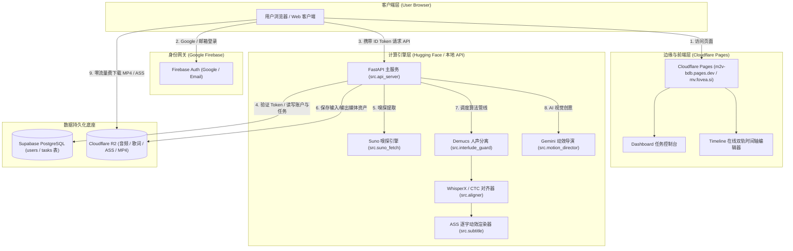
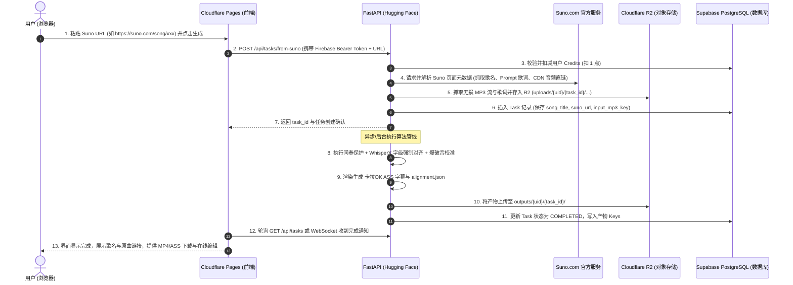

# M2V 系统架构、数据流转与云端托管白皮书

> **文档版本**: v1.0.0 (生产就绪基准)  
> **适用范围**: 生产环境运维、CI/CD 自动化构建、架构重构与多云协同  
> **核心定位**: 明确「什么代码在何处运行、什么数据在何处落盘、数据在服务间如何流转」，为全自动化运维与容器伸缩奠定基础。

---

## 目录
1. [系统整体拓扑与设计哲学](#一系统整体拓扑与设计哲学)
2. [代码拓扑与模块地图 (Code Map)](#二代码拓扑与模块地图-code-map)
3. [数据分类与存储底座 (Data & Storage Matrix)](#三数据分类与存储底座-data--storage-matrix)
4. [全链路数据流转时序 (End-to-End Data Lifecycle)](#四全链路数据流转时序-end-to-end-data-lifecycle)
5. [基础设施与多云托管规范 (Infrastructure & Hosting)](#五基础设施与多云托管规范-infrastructure--hosting)
6. [全自动化运维、监控与排错手册 (DevOps & Runbook)](#六全自动化运维监控与排错手册-devops--runbook)

---

## 一、系统整体拓扑与设计哲学

M2V 采用 **前后端彻底解耦、动静分离、算存分离、高可用多云混编** 的现代化架构：
- **静态前端与边缘分发**: 部署于 **Cloudflare Pages**（全静态 HTML/JS，零冷启动，全球 CDN 加速，无限免费流量）。
- **重计算与 AI 算力引擎**: 部署于 **Hugging Face Spaces**（16GB RAM + ZeroGPU，支持 CPU/GPU 弹性切分）。
- **持久化用户与任务状态**: 托管于 **Supabase PostgreSQL**（PostgreSQL 17，Session 连接池，跨容器重启数据永续）。
- **海量多媒体与产物资产**: 托管于 **Cloudflare R2**（S3 兼容对象存储，**0 出网带宽费 (Zero Egress)**）。
- **用户身份与鉴权**: 基于 **Firebase Authentication**（Google 登录与邮箱／密码登录）。



---

## 二、代码拓扑与模块地图 (Code Map)

代码库根目录下清晰分为前端、服务端、核心算法三大阵地：

| 模块类别 | 目录 / 核心文件 | 运行环境 / 平台 | 职责说明 |
| :--- | :--- | :--- | :--- |
| **前端应用** | `frontend/index.html` | Cloudflare Pages | 主控制台 Dashboard 页面（Suno 链接输入、文件上传、任务列表） |
| | `frontend/dashboard.js` | 浏览器运行时 | 前端主业务逻辑：Firebase 登录处理、API 通信、WebSocket 进度监听 |
| | `frontend/editor.html` | Cloudflare Pages | 独立全屏时间轴波形图编辑器 |
| | `frontend/app.js` | 浏览器运行时 | Wavesurfer 波形渲染、逐词卡拉OK对齐微调、热键控制 |
| | `frontend/firebase-config.js` | 浏览器运行时 | Firebase Web SDK 初始化（App ID: `1:961193736563:web:...`） |
| **API 服务网关** | `src/api_server.py` | HF Spaces / 本地 | FastAPI 网关：提供 `/api/auth/*`、`/api/upload`、`/api/tasks/*`、`/api/editor/*` |
| | `src/auth.py` | Python 后端 | JWT 编解码、Firebase ID Token 校验验签、用户身份拦截器 |
| | `src/schemas.py` | Python 后端 | Pydantic 数据契约（请求体、响应体、状态事件） |
| | `src/settings.py` | Python 后端 | 全局强类型配置系统（自动读取环境变量与 `.env`） |
| **持久层与存储** | `src/database.py` | Python 后端 | SQLAlchemy 2.0 Async 引擎，连接 Supabase PostgreSQL |
| | `src/models.py` | Python 后端 | 数据库 ORM 声明实体（`User`, `Task`, `UserPlan`, `TaskStatus`） |
| | `src/storage.py` | Python 后端 | 统一存储抽象层（本地磁盘 `local`、Cloudflare `r2`、标准 `s3`） |
| **核心算法管线** | `src/suno_fetch.py` | Python 后端 | Suno 页面解析、防盗链/视频流高清音频提取、Prompt 歌词清洗 |
| | `src/aligner.py` | Python 后端 | 基于 CTC / WhisperX 的中英日韩字级强制对齐引擎 |
| | `src/interlude_guard/` | Python 后端 | 纯器乐长间奏硬保护，防止无声乐段幻觉 |
| | `src/plosive_snapper.py` | Python 后端 | 爆破音与转音闭塞点毫秒级微调吸附 |
| | `src/subtitle.py` | Python 后端 | 逐字渐变卡拉OK ASS 特效字幕生成器 |
| | `src/director_engine.py` | Python 后端 | 多 Pass Gemini 视觉创意分镜导演 |

---

## 三、数据分类与存储底座 (Data & Storage Matrix)

系统中的数据被严格区分为 **4 种生命周期模型**，分别存放在对应的物理介质中：

```
┌────────────────────────────────────────────────────────────────────────┐
│                              M2V 数据分类                              │
├─────────────────┬─────────────────┬──────────────────┬─────────────────┤
│ 1. 结构化关系数据 │ 2. 非结构化资产  │ 3. 身份与凭证数据 │ 4. 临时运算态数据│
│  (Supabase PG)  │ (Cloudflare R2) │ (Firebase Auth)  │   (OS /tmp)     │
└─────────────────┴─────────────────┴──────────────────┴─────────────────┘
```

### 1. 结构化持久数据（存储于 Supabase PostgreSQL 17）
通过 SQLAlchemy AsyncPG 维护，永久保存用户和任务状态，**容器重启绝不丢失**：

#### A. 用户表 `users`
| 字段名 | 类型 | 约束 / 默认值 | 作用说明 |
| :--- | :--- | :--- | :--- |
| `id` | `VARCHAR(64)` | PRIMARY KEY | 用户全局唯一 ID（直接对应 Firebase UID） |
| `email` | `VARCHAR(255)` | UNIQUE, NOT NULL | 用户登录邮箱 |
| `username` | `VARCHAR(128)` | UNIQUE, NOT NULL | 显示昵称（取自 Google 账号或邮箱前缀） |
| `avatar_url` | `VARCHAR(512)` | NULLABLE | Google 用户头像 URL |
| `plan` | `userplan` ENUM | DEFAULT 'FREE' | 会员等级（`FREE`, `PRO`, `ENTERPRISE`） |
| `credits` | `INTEGER` | DEFAULT 5 | 剩余点数（默认赠送 5 点，生成一次扣减 1 点） |
| `is_active` | `BOOLEAN` | DEFAULT TRUE | 账号是否可用 |
| `created_at` | `TIMESTAMPTZ` | NOT NULL | 账号创建时间 |
| `last_login_at` | `TIMESTAMPTZ`| NULLABLE | 最后登录时间 |

#### B. 任务表 `tasks`
| 字段名 | 类型 | 约束 / 默认值 | 作用说明 |
| :--- | :--- | :--- | :--- |
| `id` | `VARCHAR(36)` | PRIMARY KEY | UUID 任务主键 |
| `user_id` | `VARCHAR(64)` | FK -> `users.id`, INDEX | 任务归属用户 |
| `title` | `VARCHAR(255)` | NOT NULL | 显示标题（歌名或文件名） |
| **`song_title`** | `VARCHAR(255)` | INDEX, NULLABLE | **专用歌名字段**（从 Suno 或用户输入提取） |
| **`suno_url`** | `VARCHAR(1024)`| INDEX, NULLABLE | **Suno 原曲链接**（如 `https://suno.com/song/...`） |
| `status` | `taskstatus` ENUM | DEFAULT 'PENDING' | 任务状态（`PENDING`, `PROCESSING`, `COMPLETED`, `FAILED`） |
| `current_step` | `taskstep` ENUM | DEFAULT 'QUEUED' | 执行阶段（`QUEUED`, `PREPROCESSING`, `SEPARATING`, `ALIGNING`, `SUBTITLE`, `COMPOSITING`, `DONE`, `ERROR`） |
| `progress` | `INTEGER` | DEFAULT 0 | 进度百分比 (0 ~ 100) |
| `cost_credits` | `INTEGER` | DEFAULT 1 | 本次消耗点数 |
| `input_mp3_key`| `VARCHAR(512)` | NOT NULL | 音频在 R2 中的 Object Key |
| `input_lyrics_key`| `VARCHAR(512)`| NOT NULL | 歌词在 R2 中的 Object Key |
| `output_mp4_key`| `VARCHAR(512)` | NULLABLE | 生成的 MP4 视频在 R2 中的 Object Key |
| `output_ass_key`| `VARCHAR(512)` | NULLABLE | 生成的 ASS 字幕在 R2 中的 Object Key |
| `alignment_json_key`| `VARCHAR(512)`| NULLABLE | 字级时间轴在 R2 中的 Object Key |
| `config_snapshot`| `JSON` | NULLABLE | 任务参数快照（语言、跳过分离、动效开关等） |
| `error_message` | `TEXT` | NULLABLE | 失败时的详细堆栈信息 |
| `created_at` / `completed_at` | `TIMESTAMPTZ` | - | 任务创建与完成时间戳 |

---

### 2. 非结构化多媒体资产（存储于 Cloudflare R2）
通过 `src/storage.py` 中的 `S3Storage` 统一管理，路径规范如下：

```
suno2mv-media/ (Bucket)
├── uploads/
│   └── {user_id}/
│       └── {task_id}/
│           ├── {song_title}.mp3      <-- 原始输入音频或 Suno 嗅探下载的音频
│           └── {song_title}.txt      <-- 原始或清洗后的歌词文本
└── outputs/
    └── {user_id}/
        └── {task_id}/
            ├── {song_title}.ass      <-- 高精度逐字变色卡拉OK字幕
            ├── {song_title}_alignment.json <-- 词级时间轴元数据 (供时间轴编辑器在线加载)
            └── {song_title}.mp4      <-- (可选) 压制合成的高清成品视频
```
- **访问策略**: 通过 `https://media.fovea.si/{key}` 或 S3 临时预签名（Presigned URL）安全下载。
- **费用模型**: 零出网流量费，完全免除带宽成本冲击。

---

### 3. 身份与凭证数据（Firebase Auth）
- 新的邮箱注册、邮箱登录、Google 登录和密码重置由 Firebase Authentication 处理，密码不会发送到 M2V API。旧的本地账号接口仍保留兼容，原有本地账号及密码不会自动迁入 Firebase。
- Firebase SDK 恢复浏览器会话并获取短期 ID Token；页面先等待会话恢复，再请求后端，避免使用过期缓存。
- 后端通过 Firebase 公钥验签，提取 `uid` 映射至 SQL `users` 表。邮箱是否已验证以 Firebase 的 `email_verified` 为准。
- Firebase 仅负责身份，业务用户记录、额度和任务继续使用现有 SQL 数据库；媒体继续使用 R2，不接入 Firestore。
- 自定义登录授权域名的配置与启用顺序见 [FIREBASE_AUTH.md](FIREBASE_AUTH.md)。

---

### 4. 运算态临时数据（宿主机 `/tmp` 目录）
- **生命周期**: 仅在任务运算过程中存在，函数退出即 `unlink` 清除。
- **内容**:
  - `tempfile.NamedTemporaryFile`: Suno 音频流下载中继、Demucs 伴奏分离声轨缓存 (`htdemucs/`)、WAV 格式重采样切片。

---

## 四、全链路数据流转时序 (End-to-End Data Lifecycle)

### 场景 1：用户从前端粘贴 Suno 链接并生成 MV



---

## 五、基础设施与多云托管规范 (Infrastructure & Hosting)

| 组件 | 生产托管环境 | 访问入口 / 域名 | 核心配置项与环境变量 |
| :--- | :--- | :--- | :--- |
| **前端站点** | Cloudflare Pages | `https://m2v-bdb.pages.dev`<br>`https://mv.fovea.si` | 构建命令: `cd frontend/motion && npm ci && npm run build:pages`<br>发布目录: `frontend`<br>重写路由: `frontend/_redirects`<br>安全头: `frontend/_headers` |
| **AI 算力后端** | Hugging Face Spaces | `https://lucazhou-suno2mv-api.hf.space` | 运行环境: Python 3.11 + ZeroGPU<br>`DATABASE_URL`: Supabase 连接串<br>`STORAGE_BACKEND`: `r2`<br>`R2_*`: Cloudflare 凭证<br>`GEMINI_API_KEY`: 导演模型密钥 |
| **本地开发后端** | macOS 本地进程 | `http://127.0.0.1:8000` | 配置文件: 本地 [`.env`](file:///Users/luca/suno2MV/.env)<br>启动命令: `.venv/bin/python -m src.api_server` |
| **云端关系库** | Supabase Cloud | `aws-0-us-east-1.pooler.supabase.com:5432` | 数据库类型: PostgreSQL 17.11<br>连接模式: Session Pooler (兼容 IPv4/IPv6)<br>项目 Ref: `ixbtwrntrskxeeoymcqy` |
| **对象存储** | Cloudflare R2 | `https://media.fovea.si` | Bucket: `suno2mv-media`<br>权限: 私有写入，公共域名只读或预签名直传 |
| **用户认证** | Google Firebase | `https://dc-test-731fa.firebaseapp.com` | 项目: `dc-test-731fa`<br>已授权域名: `m2v-bdb.pages.dev`, `mv.fovea.si` |

---

## 六、全自动化运维、监控与排错手册 (DevOps & Runbook)

### 1. 快速健康巡检指令（一键自检）

```bash
# 1. 检查 Supabase 数据库连通性与用户表状态
.venv/bin/python -c "
import asyncio, asyncpg, os
from src.settings import get_settings
async def check():
    db_url = get_settings().DATABASE_URL.replace('postgresql+asyncpg://', 'postgresql://')
    conn = await asyncpg.connect(db_url)
    users = await conn.fetchval('SELECT count(*) FROM users;')
    tasks = await conn.fetchval('SELECT count(*) FROM tasks;')
    print(f'✅ Supabase 正常: 用户数={users}, 任务数={tasks}')
    await conn.close()
asyncio.run(check())
"

# 2. 检查 Cloudflare R2 对象存储连通性
.venv/bin/python -c "
import boto3, os
from src.settings import get_settings
s = get_settings()
s3 = boto3.client('s3', endpoint_url=f'https://{s.R2_ACCOUNT_ID}.r2.cloudflarestorage.com',
                  aws_access_key_id=s.R2_ACCESS_KEY_ID, aws_secret_access_key=s.R2_SECRET_ACCESS_KEY)
resp = s3.list_buckets()
print('✅ Cloudflare R2 正常: 存储桶列表 =', [b['Name'] for b in resp['Buckets']])
"

# 3. 检查 Hugging Face Spaces 生产后端响应
curl -sI https://lucazhou-suno2mv-api.hf.space/docs | head -n 5
```

---

### 2. 常见故障场景与应急恢复方案

#### 场景 A：前端提示「后端 API 尚未连通：当前域名仅为纯前端静态页面」
- **根因**: 前端直接向当前静态域名（如 `m2v-bdb.pages.dev/api/...`）发起了 API 请求，但 Cloudflare Pages 是纯静态托管，返回了 `index.html`。
- **解法**:
  1. 打开页面右上角 **「⚙️ API」** 设置。
  2. 填入运行中的后端真实地址（例如测试时填 `http://localhost:8000`，云端填 `https://lucazhou-suno2mv-api.hf.space`）。

#### 场景 B：Supabase 数据库报告 `nodename nor servname provided`
- **根因**: 本地或某些海外云网络无 IPv6 解析，而 Supabase 的直接域名 `db.<ref>.supabase.co` 仅提供 IPv6。
- **解法**: 确保 `DATABASE_URL` 走 Supavisor 连接池域名：
  `postgresql+asyncpg://postgres.<ref>:<pwd>@aws-0-us-east-1.pooler.supabase.com:5432/postgres`

#### 场景 C：Google 登录弹窗报 `auth/unauthorized-domain`
- **根因**: 访问前台的新域名未在 Firebase 白名单中。
- **解法**: 登录 Firebase Console → Authentication → Settings → Authorized domains，添加新域名（如 `mv.fovea.si`）。

---

### 3. CI/CD 全自动构建与上线流程

1. **前端部署**: 本地修改 `frontend/` 内容后 `git push origin main`：
   - GitHub 自动触发 Cloudflare Pages Webhook。
   - Cloudflare Pages 自动克隆、打包并无缝部署至全球边缘 CDN（耗时通常 < 15 秒）。
2. **后端服务**:
   - Hugging Face Spaces 绑定了 GitHub 仓库，`main` 分支变动自动触发 Space 容器重新加载。
   - 启动时通过 `lifespan` 自动执行 `create_tables()`，任何新加入的模型表或字段平滑映射。
