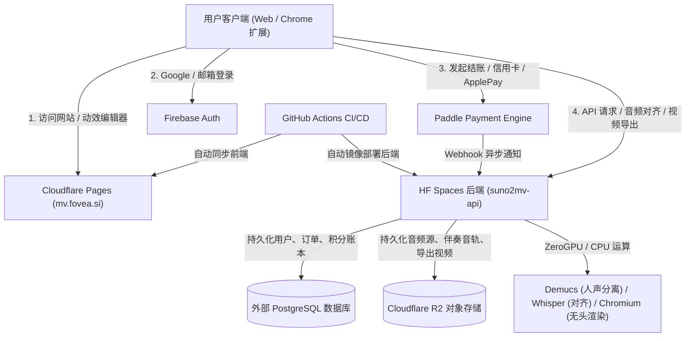

# Fovea Studio (Suno2MV) 线上运维与稳定性保障手册

> **文档版本**: 1.0 (生产环境就绪版)  
> **更新日期**: 2026-10-28  
> **适用服务**: 前端 `mv.fovea.si` (Cloudflare Pages) + 后端 `suno2mv-api` (Hugging Face Spaces) + 数据库 (PostgreSQL) + 对象存储 (Cloudflare R2) + 支付 (Paddle)

---

## 目录
1. [系统拓扑与核心依赖全景](#1-系统拓扑与核心依赖全景)
2. [Token 与密钥周期管理表（核心防翻车）](#2-token-与密钥周期管理表核心防翻车)
3. [Hugging Face 容器特性与稳定性避坑](#3-hugging-face-容器特性与稳定性避坑)
4. [核心故障应急排查字典 (Runbook)](#4-核心故障应急排查字典-runbook)
5. [支付与资损安全运维 (Paddle Billing)](#5-支付与资损安全运维-paddle-billing)
6. [数据持久化与自动备份方案](#6-数据持久化与自动备份方案)
7. [生产日常巡检清单 (Daily / Weekly Checklist)](#7-生产日常巡检清单-daily--weekly-checklist)
8. [重大事故应急与一键回滚流程](#8-重大事故应急与一键回滚流程)

---

## 1. 系统拓扑与核心依赖全景



| 模块 | 基础设施 | 域名 / 入口 | 核心职责 |
|---|---|---|---|
| **Web 前端** | Cloudflare Pages | `https://mv.fovea.si` | 静态营销页、Web 客户端、Motion Studio 动效工作区 |
| **API 后端** | Hugging Face Spaces | `https://lucazhou-suno2mv-api.hf.space` | 业务路由、JWT 签发、AI 推理调度、Webhook 接收 |
| **主数据库** | 托管 PostgreSQL | 数据库连接串 (`DATABASE_URL`) | 用户、项目、积分流水、扣费凭证、Paddle 订单 |
| **媒体存储** | Cloudflare R2 | S3 兼容 API (`suno2mv-media`) | 原始 MP3、对齐时间戳、人声/伴奏轨道、已导出 MP4 |
| **支付结算** | Paddle | `api.paddle.com` | 订阅计费、自动算税、收据邮件、续订通知 |
| **用户认证** | Firebase Auth | `dc-test-731fa` (Google OAuth) | 用户登录、注册、ID Token 签发与 JWKS 验签 |

---

## 2. Token 与密钥周期管理表（核心防翻车）

在线上运维中，**Token/Secret 失效是发生率最高、最具破坏性的故障源**。以下是全系统全部密钥的台账与管理规范：

| 密钥名称 | 存放位置 | 有效期 / 轮转要求 | 失效后果与故障表象 | 紧急恢复 / 检查方法 |
|---|---|---|---|---|
| **`HF_TOKEN`** | GitHub 仓库 `Secrets -> Actions` | 建议不过期或 1 年轮转；若为 User Token 则随密码修改失效 | CI 部署任务 `deploy-to-hf` 报 401/403，代码无法自动推送到后端 | 登录 Hugging Face -> Settings -> Access Tokens，新建 `Write` 权限 Token，更新 GitHub Secret |
| **`CLOUDFLARE_API_TOKEN`** | GitHub 仓库 `Secrets -> Actions` | 视创建时设置的 TTL，通常 1 年 | CI 部署任务 `deploy-to-pages` 报 401/403，前端页面更新失败 | 登录 Cloudflare Dashboard -> My Profile -> API Tokens，重新生成具备 Cloudflare Pages 编辑权限的 Token |
| **`SECRET_KEY`** | HF Spaces 环境变量 (Settings) | **长期固定，绝对不可每次启动随机生成** | 一旦改变，**全站所有已登录用户的 Access Token 立即失效**，全部被踢下线并报 401 | 生产必须固定一个由 `openssl rand -hex 32` 生成的高强度密钥写入 HF Secrets |
| **`PADDLE_API_KEY`** | HF Spaces 环境变量 (Settings) | 正式环境 API 密钥 | 网站订阅页打不开，或结账创建交易报 503 (`Paddle credentials do not match`) | 登录 Paddle 商家后台 -> Developer tools -> Authentication -> 检查 API Key 权限 (`transaction`, `price`, `checkout-domain`) |
| **`PADDLE_CLIENT_TOKEN`** | HF Spaces 环境变量 (Settings) | 与 API Key 对应配套 | 前端 Paddle.js 初始化失败，用户点击订阅无反应或弹窗拒绝 | Paddle 后台 -> Authentication -> Client-side tokens，核对以 `live_` 开头的正式 Token |
| **`PADDLE_WEBHOOK_SECRET`** | HF Spaces 环境变量 (Settings) | 创建 Notification Webhook 时生成，以 `pdl_ntfset_...` 开头 | **致命**：用户已扣款但积分未到账！日志大量报 `Paddle signature validation failed (401)` | 进入 Paddle -> Notifications -> 查看对应 Webhook 的 Secret Key，确保与 HF 环境变量完全一致 |
| **`R2_SECRET_ACCESS_KEY`** | HF Spaces 环境变量 (Settings) | 长期有效 | 音频上传失败、分离音频加载 404、视频导出保存失败 | Cloudflare Dashboard -> R2 -> Manage R2 API Tokens -> 重新生成并更新 HF 环境变量 |
| **`DATABASE_URL` (PG 密码)** | HF Spaces 环境变量 (Settings) | 长期有效（需关注云数据库实例是否被休眠或连接池打满） | 后端启动直接崩溃或所有 API 报 500 / 数据库连接超时 | 检查 PostgreSQL 服务商（如 Supabase / Neon），确认连接串密码，特别注意密码中特殊符号需 URL 编码 |

---

## 3. Hugging Face 容器特性与稳定性避坑

Hugging Face Spaces 提供了开箱即用的 GPU/CPU 容器，但在生产长期运行下有以下必须严格遵照的特性：

### 3.1 免费 Space 自动休眠（Sleep Mode）与保活
* **机制**：HF 免费 Space 若在 **48 小时内无任何 HTTP 请求**，系统将自动挂起（Sleeping）。
* **故障现象**：真实用户首次访问前端并调用接口时，前端一直转圈，等待 60~90 秒后甚至超时报 504 Gateway Timeout（冷启动期间容器重新加载模型和 Python 进程）。
* **保活策略 (SOP)**：
  1. **方案 A（付费保活）**：在 Hugging Face Space 设置中升级硬件为持久运行的实例（如 CPU Basic Persistent 或带持续算力档位），确保不进入 Sleep 状态。
  2. **方案 B（外部探活定时 ping）**：
     * 使用免费的监控服务（如 [UptimeRobot](https://uptimerobot.com)、[BetterStack](https://betterstack.com) 或 cron-job.org）。
     * 配置 HTTP 监控探针，每 **5 分钟** 发起一次 GET 请求探测健康检查接口：  
       `https://lucazhou-suno2mv-api.hf.space/` 或 `https://lucazhou-suno2mv-api.hf.space/api/health`
     * 作用：既能阻止 Space 进入休眠，又能在服务不可用时第一时间给运维邮箱/手机发送报警通知。

### 3.2 容器临时磁盘擦除风险（Ephemeral Disk）
* **机制**：HF Space 的容器文件系统（除挂载的 Persistent Storage 目录外）**在容器重启、代码重新部署或崩溃恢复时会全部重置并清空**！
* **致命陷阱**：
  * 若生产仍然使用默认的 `DATABASE_URL=sqlite+aiosqlite:///./m2v.db`，**每一次代码 push 部署，所有用户数据、积分余额和购买记录将瞬间灰飞烟灭！**
  * 若生产使用本地存储目录 `STORAGE_BACKEND=local`，所有生成的音频和视频片段在重启后全部 404！
* **铁律配置（必须在 HF Settings -> Variables and secrets 中配置）**：
  ```bash
  # 必须使用外部托管的 PostgreSQL，绝对不能留空或使用 sqlite
  DATABASE_URL=postgresql+asyncpg://<USER>:<PASSWORD>@<HOST>:<PORT>/<DB>

  # 必须开启 R2 对象存储
  STORAGE_BACKEND=r2
  R2_ACCOUNT_ID=<Cloudflare_Account_ID>
  R2_ACCESS_KEY_ID=<R2_Key_ID>
  R2_SECRET_ACCESS_KEY=<R2_Secret>
  R2_BUCKET_NAME=suno2mv-media
  R2_PUBLIC_DOMAIN=https://media.fovea.si  # 或 R2 公共域名
  ```

### 3.3 内存峰值与 OOM (Exit Code 137) 闪退
* **机制**：HF 基础容器内存上限为 **16GB**。
  * 当多个并发请求同时调用 Demucs 人声分离（深度学习 PyTorch 推理）、Whisper 时间轴对齐、或 Chromium Playwright 无头视频逐帧渲染时，内存极易突破 16GB。
  * Linux 内核的 OOM-Killer 会直接强制终止主进程，表现为容器瞬间重启，日志中出现 `Killed` 或 `Container terminated with exit code 137`。
* **防护机制**：
  1. **并发限流守门员**（已内置于 `src/settings.py`）：
     * `MAX_GLOBAL_CONCURRENT_RENDERS=4`（全局最多允许 4 个服务端渲染并发）。
     * `MAX_CONCURRENT_RENDERS_PER_USER=2`（单用户最多 2 个渲染排队）。
  2. **端渲染分流（客户端优先）**：
     * 前端 Motion Studio 默认启用了 **WebCodecs 本地浏览器硬件加速导出**。
     * 用户在 Chrome/Edge 浏览器导出时，使用的是其自身电脑的 GPU，不消耗服务器内存和 CPU。运维中应确保引导用户优先使用现代浏览器，将服务端渲染仅作为保底备用。

---

## 4. 核心故障应急排查字典 (Runbook)

### 故障 1: 访问 `https://mv.fovea.si/pricing` 提示 503 / 套餐加载失败
* **典型报错信息**：
  * `{"detail": "Paddle credentials do not match the selected environment"}`
  * `{"detail": "Test billing requires an explicitly isolated test deployment"}`
  * `{"detail": "Billing is currently disabled"}`
* **排查步骤**：
  1. 打开浏览器开发者工具（F12）-> Network -> 查看 `/api/payments/config` 或 `/api/payments/packages` 接口返回的响应详情。
  2. 登录 Hugging Face -> 进入 `LucaZhou/suno2mv-api` -> **Settings** -> **Variables and secrets**。
  3. 核对以下 5 个关键环境变量：
     * `BILLING_ENABLED`: 是否为 `true`？
     * `BILLING_PROVIDER`: 必须为 `paddle`（而非旧的 `lemonsqueezy`）。
     * `PADDLE_ENVIRONMENT`: 正式环境必须为 `production`。
     * `PADDLE_LIVE_ENABLED`: 正式环境上线收费必须为 `true`。
     * `PADDLE_API_KEY`: 必须以 `pdl_live_` 开头，且不能含有前后空格或引号。
  4. 本地执行预检命令直接定位差异：
     ```bash
     python -m scripts.billing_preflight --config work/paddle-live.env --prepare
     ```

---

### 故障 2: 用户点击“订阅”弹窗报错或白屏
* **典型报错信息**：
  * Paddle 弹出弹窗提示 `Domain not approved` 或 `Unable to start checkout`
  * 控制台报错 `Client token invalid`
* **排查与解决**：
  1. **域名白名单审查**：登录 Paddle 商家后台 -> **Checkout** -> **Checkout domains**。检查 `mv.fovea.si`（带具体子域名）是否处于 `Approved` 状态。
  2. **客户端 Token 配对**：检查 HF 环境变量中的 `PADDLE_CLIENT_TOKEN` 是否为正式 `live_...` 开头的 Token。
  3. **沙盒/正式混用拦截**：检查代码是否误在生产环境传递了测试参数。若 `PADDLE_LIVE_ENABLED=true`，系统会自动阻断任何以 `test_` 开头的 Token，防止盗刷。

---

### 故障 3: 用户付了款，但网站积分长时间未增加（掉单）
* **排查步骤**：
  1. **检查 Paddle Webhook 发送日志**：
     * 登录 Paddle 商家后台 -> **Developer Tools** -> **Notifications** / **Webhooks**。
     * 点击通知历史，搜索该笔支付（Event Name 为 `transaction.completed` 或 `subscription.activated`）。
     * 查看 HTTP 状态码：
       * 若状态码为 **401 Unauthorized**：说明 HF 后端的 `PADDLE_WEBHOOK_SECRET` 与 Paddle 后台当前 Webhook 的签名密钥不匹配！
       * 若状态码为 **502 / 504 / Connection Refused**：说明 HF 容器当时处于冷启动、重启或宕机状态。Paddle 会自动按指数退避算法在后续 **3 天** 内持续重试。
  2. **检查后端去重收件箱**：
     * 打开后端数据库，执行 SQL 查询收件箱：
       ```sql
       SELECT * FROM paddle_inbox ORDER BY received_at DESC LIMIT 10;
       ```
     * 确认事件是否已送达、处理状态是否为成功。
  3. **人工紧急补发积分 (SOP)**：
     * 若用户客服催促，确认 Paddle 后台真实扣款成功后，运维可在管理员环境直接补发积分：
       ```python
       # 执行临时补单脚本（指定用户邮箱与充值积分）
       from src.database import async_session
       from src.credits import grant_paid_credits
       # 依据对应套餐增加积分并记录唯一交易流水
       ```

---

### 故障 4: GitHub Actions CI 自动构建/部署突然失败
* **典型排查场景**：
  * **场景 A: `deploy-to-hf` 步骤失败**
    * 报错：`Authentication failed` 或 `git push --force ... 403`
    * 根因：`HF_TOKEN` 过期或没有 Write 权限。前往 GitHub 仓库 -> Settings -> Secrets -> 更新 `HF_TOKEN`。
  * **场景 B: `deploy-to-pages` 步骤失败**
    * 报错：`Missing CLOUDFLARE_API_TOKEN` 或 `Failed to publish`
    * 根因：Cloudflare Token 权限不足或到期。前往 Cloudflare 刷新 API Token。
  * **场景 C: `Run Hugging Face Entrypoint & Route Integrity Test` 失败**
    * 报错：`AssertionError: Route integrity check failed`
    * 根因：新增了 API 路由，但未在 `app.py` 或 `tests/test_hf_entrypoint.py` 中声明；必须在本地复跑 pytest 修复后重新 push。

---

### 故障 5: 用户登录失效，提示 401 Unauthorized / Token Expired
* **排查步骤**：
  1. **检查 `SECRET_KEY` 是否被意外重置**：如果有人改动了 HF 环境变量中的 `SECRET_KEY`，所有用户本地签发的 JWT 解密验签均会失败。此时用户只需**重新登录一次**即可重新获取最新有效 Token。
  2. **Firebase Token 验签失败**：检查用户是否通过 Google 登录。后端的 `src/auth.py` 会从 Google 官方 JWKS 地址拉取公钥（`googleapis.com/service_accounts/v1/jwk/securetoken@system.gserviceaccount.com`）。如果服务器所在地区访问 Google 公网接口被墙或 DNS 解析失败，会导致第三方登录校验失败。

---

## 5. 支付与资损安全运维 (Paddle Billing)

上线收费后，资金安全与防刷机制至关重要：

### 5.1 防薅羊毛与退款追回机制（已内置）
* **防重复到账**：`paddle_inbox` 数据库表记录了所有处理过的 Paddle Event ID。任何重放攻击或重复推送的 Webhook 会被幂等机制秒级忽略，绝不重复发币。
* **退款自动扣回**：当用户在 Paddle 申请退款并获批后，Paddle 发送 `transaction.revised` 或退款事件：
  * 系统会自动从用户账户中扣减对应套餐积分。
  * 若用户已将积分挥霍完毕，其积分账户将**转为负数负债（Credit Debt）**，其在清偿前无法发起任何消耗性任务，防止恶意付费、生成、退款套现。
* **订阅到期自动清零**：月订阅积分具有到期周期，用户如果在月底未消耗完，到期自动过期，避免无限滚存造成算力挤兑。

### 5.2 生产正式切换核对清单
在切换为真实收款前，运维必须逐项确认：
- [ ] Paddle 账户 Contact Email 已在 Paddle 后台核验完毕并保持畅通。
- [ ] Paddle 正式环境下的 `mv.fovea.si` 域名审批状态为 `Approved`。
- [ ] 三档订阅价格已在生产库正确配置：
  * Creator ($9.99 / 300 积分): `pri_01m612h4qvfyrw9gtgcbpb3gnj`
  * Pro ($19.99 / 800 积分): `pri_01m612h5q8w87gc0mr32yy4kq2`
  * Studio ($29.99 / 1,500 积分): `pri_01m612h6m0rnsn7rdba9e3j4hx`
- [ ] `work/paddle-live.env` 严禁提交至 Git 仓库。
- [ ] 线上完成 1 笔真实付款验收（付款 -> 邮件收据 -> 积分实时到账 -> 扣费对齐测试 -> 取消续订验证）。

---

## 6. 数据持久化与自动备份方案

### 6.1 数据库备份命令
系统在 [`src/backup.py`](file:///Users/luca/suno2MV/src/backup.py) 中内置了数据库备份与数据完整性校验工具：

```bash
# 执行数据库完整性快照备份
python -c 'from src.backup import create_database_backup; print(create_database_backup())'
```
* **备份产物**：
  * `./backups/db_backup_<timestamp>.sqlite3` 或 `.dump`
  * `./backups/db_backup_<timestamp>.manifest.json`（包含各表数据行数、文件 SHA256 校验和、PRAGMA integrity 报告）

### 6.2 灾备建议
1. **PostgreSQL 云数据库自动快照**：
   * 在 Supabase / Neon / 云服务商后台开启**每日自动备份**，至少保留 7 天历史快照。
2. **异地冷备**：
   * 定期将导出的 `.dump` 文件同步归档至不同的存储服务（如 AWS S3 或加密冷盘）。

---

## 7. 生产日常巡检清单 (Daily / Weekly Checklist)

### 每日 1 分钟快速核验（晨检）
1. 打开浏览器隐身窗口，访问 `https://mv.fovea.si`，确认首页加载正常且无 CDN 报错。
2. 访问 `https://mv.fovea.si/pricing`，确认三档订阅卡片显示正常、价格与权益文字无乱码。
3. 检查探活监控（UptimeRobot）是否有过非预期 Downtime 告警。
4. 登录 Paddle 商家后台首页，确认今日无异常的高退款率或交易拒付（Dispute）。

### 每周维护核验（周五）
1. **HF 容器状态检查**：打开 Hugging Face Space 控制台，查看过去 7 天的 CPU、RAM 负载曲线，排查是否有持续上升的内存泄露迹象。
2. **存储配额巡查**：登录 Cloudflare Dashboard -> R2 -> 查看存储桶容量与计费情况，清理 30 天前的废弃临时合成缓存。
3. **Webhook 告警审计**：在 Paddle 后台 Webhook 列表核对“Failed Deliveries”指标，排查是否有未成功投递的历史事件。
4. **Token 倒计时评估**：核对即将到期的 API Token（特别是季度或年度轮转的证书）。

---

## 8. 重大事故应急与一键回滚流程

当发布新版本导致线上核心功能不可用（例如视频全部合成失败、支付全面报错）时，启动应急回滚：

### 8.1 代码与后端紧急回滚 (Git Revert)
```bash
# 1. 查找上一个稳定可用的 Commit ID
git log -n 5 --oneline

# 2. 回滚破坏性提交并生成回滚 Commit
git revert <faulty_commit_id> -m 1  # 若为合并提交加 -m 1，普通提交直接 git revert <commit_id>

# 3. 运行本地安全验证
pytest tests/test_hf_entrypoint.py -v

# 4. 推送到主分支，触发 GitHub Actions 自动化部署回退
git push origin main
```

### 8.2 前端秒级回滚 (Cloudflare Pages Instant Rollback)
如果仅是前端发布问题，不需要等待重新构建：
1. 登录 [Cloudflare Dashboard](https://dash.cloudflare.com)。
2. 进入 **Workers & Pages** -> 选择你的项目名。
3. 找到 **Deployments** 列表。
4. 找到上一次运行良好的部署版本，点击右侧的 **Rollback to this deployment**。
5. 全球边缘节点将在 **10 秒内**完成前端瞬间回滚！
